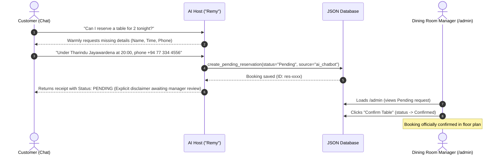

# MiniKitchen — Artisanal Seasonal Dining & Management Platform

MiniKitchen is an artisanal, Michelin-inspired dining web application and management platform. It features an anti-AI slop public dining website, a secure operational admin dashboard, and an intelligent AI concierge ("Remy") powered directly by the Google Gemini API with automated table reservation workflows.

---

## 📋 Table of Contents
- [Quick Start & Credentials](#-quick-start--credentials)
- [Key Workflows](#-key-workflows)
- [System Architecture](#-system-architecture)
- [Environment Variables & AI Configuration](#-environment-variables--ai-configuration)
- [Data Setup & Persistence](#-data-setup--persistence)
- [Local Installation](#-local-installation)

---

## 🔑 Quick Start & Credentials

| Resource | Path / URL | Access Credentials |
| :--- | :--- | :--- |
| **Public Dining Website** | `/` (Home) | Public access |
| **Admin Portal** | `/admin` | Requires session authentication |
| **Admin Login** | `/admin/login` | **Username:** `admin`<br>**Password:** `minikitchen2026` |

> 💡 **Evaluator Testing Note**: For easy testing and evaluation access, a direct link to the **Admin Portal** (`/admin/login`) is conveniently placed inside the top-right hamburger navigation menu on the homepage.

---

## 🚀 Key Workflows

### 1. AI Concierge Must-Pass Workflow ("Remy")
- **Conversational Inquiries**: Guests can ask about menu dishes, ingredients, dietary accommodations (**Gluten-Free**, **Vegan**, **Vegetarian**), opening hours, and Colombo location details with prices in Sri Lankan Rupees (**LKR**).
- **Multi-Turn Detail Gathering**: When a guest indicates intent to reserve a table (e.g. *"I'd like a table tonight"*), Remy identifies missing details and politely asks for:
  - Guest Full Name
  - Guest Count (party size)
  - Date & Time
  - Contact Number or Email
- **Guaranteed Pending Status**: Once all details are gathered, Remy calls the internal `create_pending_reservation` tool to persist the reservation into the database.
- **Strict Non-Confirmation Rule**: The AI concierge **strictly never confirms** a reservation. It provides a booking receipt marked **`Status: PENDING`** with an explicit notice that a dining room manager must approve seating before it is confirmed.
- **Manager Approval**: The reservation immediately appears in `/admin` under the **Pending** tab with source label `AI Concierge (Remy)`. The manager clicks **Confirm Table** to officially confirm it.



### 2. Public Table Reservation Form
- Bespoke party size stepper (`— 2 +`), curated Lunch/Dinner service session chips, and clean underline inputs.
- Submits directly to `/api/reservations` with status `Pending` and generates an instant digital reservation token with reference ID.

### 3. Real-Time Admin Operations & Menu Sync
- **Mobile-Optimized Management**: Responsive controls with touch-friendly swipeable tabs for phone, tablet, and desktop viewports.
- **Live Menu Availability**: Managers can toggle any dish between `● Available` and `○ Sold Out` with one click. Sold-out dishes immediately desaturate on the public website with strikethrough pricing (`~~LKR 6,200~~ Sold out`), and Remy the AI automatically warns inquiring guests in chat.
- **Dish Creation & Editing**: Add new seasonal creations with categories, prices, and dietary tags or edit existing items.
- **7-Day Service Schedule & Hours**: Change opening/closing times per day and toggle closure days (`○ Closed / Rest Day` $\leftrightarrow$ `● Open Service`).
- **Identity & Contact Info**: Update telephone, address, and email dynamically.

### 4. Automated Notification Dispatch Preparation (WhatsApp / SMS / Email)
- When a manager clicks **"Confirm Table"** in `/admin`:
  - The status is immediately saved as **`Confirmed`** in the persistent database.
  - A notification drawer pops up automatically with pre-filled guest and booking details.
  - **1-Click WhatsApp**: Formatted `https://wa.me/...` URL with personalized booking message.
  - **1-Click Native SMS**: Opens the device's native messaging application with recipient phone and body ready to send.
  - **1-Click Email**: Pre-filled `mailto:` link with subject line and formal confirmation text.
  - **Live Editable Draft**: Changes typed in the draft reflect instantly in all dispatch links, with a 1-click **"Copy Text"** clipboard button.

---

## 🏗 System Architecture

```
minikitchen/
├── data/
│   └── restaurant.json       # Atomic file-based document database (menu, reservations, hours)
├── public/
│   └── images/menu/          # Authentic food photography assets
├── src/
│   ├── app/
│   │   ├── admin/
│   │   │   ├── login/        # Session login with 1-click demo access
│   │   │   └── page.tsx      # Admin dashboard (Reservations, Menu, Operations)
│   │   ├── api/
│   │   │   ├── auth/         # Login, logout, session verification
│   │   │   ├── chat/         # AI Concierge endpoint (Gemini API & fallback)
│   │   │   ├── menu/         # Menu CRUD & availability toggle
│   │   │   ├── reservations/ # Table reservation CRUD & status management
│   │   │   └── restaurant/   # Operating hours & location API
│   │   ├── layout.tsx        # Global fonts, metadata & layout frame
│   │   └── page.tsx          # Public restaurant homepage
│   ├── components/
│   │   ├── HeroSection.tsx   # Mayot Michelin-inspired layout & circular CTA
│   │   ├── MenuSection.tsx   # 4 seasonal categories, LKR prices, anti-slop cards
│   │   ├── ReservationSection.tsx # Stepper, service chips, digital voucher
│   │   ├── ContactSection.tsx     # 7-day schedule with live "Today" indicator
│   │   ├── ChatWidget.tsx    # Floating Remy AI host concierge
│   │   └── Footer.tsx        # Minimalist luxury footer (Since 2018)
│   └── lib/
│       ├── db.ts             # Atomic file database engine with mutex locking
│       ├── gemini.ts         # Google Gen AI SDK integration & tool declarations
│       └── types.ts          # Complete TypeScript domain models
└── .env.local                # Local environment secrets (ignored by git)
```

---

## ⚙️ Environment Variables & Database Configuration

Create a `.env.local` file in the project root:

```env
# 1. Google Gemini API (Recommended & Free Tier):
#    Get your free API key at: https://aistudio.google.com/app/apikey
GEMINI_API_KEY=your_gemini_api_key_here

# Model Selection (defaults to gemini-3.1-flash-lite for ~1.6s ultra-fast responses)
GEMINI_MODEL=gemini-3.1-flash-lite

# 2. Supabase Persistent Cloud Database (Optional for Multi-Device Global Sync):
#    Provides instant live synchronization across multiple devices, mobile phones, and laptops:
NEXT_PUBLIC_SUPABASE_URL=https://your-project.supabase.co
NEXT_PUBLIC_SUPABASE_ANON_KEY=your_supabase_anon_key_here
```

### AI Resilience & Auto-Failover
- **Primary Model**: `gemini-3.1-flash-lite` (~1.6s response time, high free-tier quota).
- **Auto-Failover Queue**: Automatically cascades through `gemini-3.5-flash` $\rightarrow$ `gemini-3.7-flash` if any model reaches temporary network congestion.
- **Zero-Failure Fallback Engine**: If no API key is provided, an intelligent local culinary engine seamlessly handles menu questions and multi-turn reservation extraction without throwing 500 errors.

---

## 💾 Data Setup & Dual-Layer Persistence

MiniKitchen features a dual-layer persistence architecture designed for zero configuration locally and global persistence in production:

1. **Production Cloud Database (Supabase)**:
   - When `NEXT_PUBLIC_SUPABASE_URL` and `NEXT_PUBLIC_SUPABASE_ANON_KEY` are provided, the application connects to a Supabase PostgreSQL database.
   - All table reservations, menu availability toggles, and schedule adjustments synchronize across all devices and serverless lambdas globally.
   - Initial schema and seed data are available in [`supabase-schema.sql`](supabase-schema.sql).

2. **Zero-Setup Local Fallback (Atomic JSON)**:
   - If Supabase is not configured, the database automatically falls back to an atomic JSON file store located at [`data/restaurant.json`](data/restaurant.json).
   - In serverless environments, writes are routed to `/tmp` with an in-memory fallback cache to ensure zero request crashes.

---

## 💻 Local Installation

1. **Clone the repository**:
   ```bash
   git clone <your-repository-url>
   cd minikitchen
   ```

2. **Install dependencies**:
   ```bash
   npm install
   ```

3. **Configure Environment** (Optional for custom Gemini Key):
   ```bash
   cp .env.example .env.local
   # Paste your GEMINI_API_KEY inside .env.local
   ```

4. **Run Development Server**:
   ```bash
   npm run dev
   ```

5. **Open in Browser**:
   - Public Website: [http://localhost:3000](http://localhost:3000)
   - Admin Dashboard: [http://localhost:3000/admin](http://localhost:3000/admin)

6. **Validate Production Build**:
   ```bash
   npm run build
   ```

